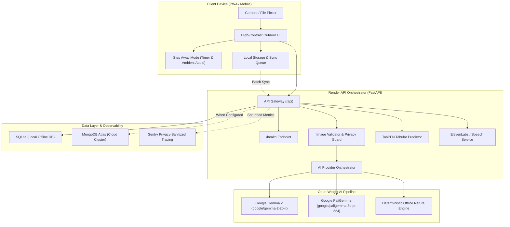

<div align="center">

# 🌿 TrailLens

### *See something. Understand it. Step away.*

[](https://github.com/traillens/traillens/actions/workflows/ci.yml)
[](LICENSE)
[](#2-why-touch-grass)
[](#6-open-source-ai-model)
[](https://render.com/deploy)

**An outdoor AI companion built with open-weight intelligence designed to get people off screens and into the natural world.**

[Quickstart](#7-local-setup) &bull; [Architecture](#5-architecture) &bull; [Open Models](#6-open-source-ai-model) &bull; [Offline Mode](#8-offline-mode) &bull; [Render Deployment](#9-render-deployment) &bull; [Docs](docs/)

</div>

---

## 1. Project Overview

Most consumer AI applications optimize for a single metric: **screen time**. Chatbots entice users into infinite conversational loops, image generators encourage endless tweaking behind monitors, and social feeds trap attention indoors.

**TrailLens flips the paradigm.**

TrailLens is an outdoor companion built around a strict product philosophy:
> **AI should make the outdoor experience easier and more interesting, then immediately get out of your way.**

When an explorer is on a trail and encounters an organism—a flower, shelf fungus, unusual leaf shape, beetle, or rock—TrailLens provides immediate, high-signal understanding powered by **open-weight AI (Google Gemma 2 / PaliGemma architecture)**. It returns:
1. **Likely Identification:** Common name, binomial Latin classification, and an honest confidence score.
2. **Three Naked-Eye Physical Cues:** Specific physical details to look for immediately with your own eyes (e.g. leaf veins, bark furrows, pollinator presence).
3. **An Actionable Outdoor Challenge:** A 2–5 minute physical activity requiring zero screen time.
4. **Step-Away Mode:** A dedicated screen-break interface with a countdown ring, gentle 432Hz ambient chime, and explicit instructions to pocket your device.

Once the challenge is complete, the explorer returns briefly to log their findings into an **offline-first Field Journal**.

---

## 2. Why Touch Grass

TrailLens was built specifically for **Hacktoberfest 2026 Open-Source AI Challenge Week 1: "Touch Grass"**.

The challenge prompt mandates:
> *"Build something with open-source AI at its core that gets people off the screen and into the world."*

To satisfy both dimensions authentically:
- **Zero Chat Loops:** TrailLens has no conversational chatbot, no endless typing, and no notification hooks.
- **Zero Gamification Traps:** No artificial streaks that penalize missing days, no vanity points, and no follower feeds.
- **Micro-Dose AI:** Every interaction follows a one-shot pattern:
  $$\text{Photo} \longrightarrow \text{Open AI Analysis} \longrightarrow \text{Micro-Observations} \longrightarrow \text{Phone Away} \longrightarrow \text{Real World}$$
- **Physical Sensory Immersion:** Challenges emphasize tactile bark touch, acoustic birdsong triangulation, leaf geometry, and soil aroma (geosmin).

---

## 3. Demo

- **Live Production URL:** [https://traillens.onrender.com](https://traillens.onrender.com)
- **Zero-Config Demo Engine:** Ships with a deterministic offline botanical and entomological reasoning engine that operates out of the box with zero GPU or API keys required.
- **Video Walkthrough Script:** Check [`docs/demo-script.md`](docs/demo-script.md) for a complete second-by-second 90-second video storyboard.
- **Field Test Protocol:** Check [`docs/real-world-test-checklist.md`](docs/real-world-test-checklist.md) for the live trail testing checklist.

---

## 4. Features

- 📸 **One-Shot Nature Identification:** Upload or snap photos of flora, fauna, fungi, and geological features using mobile cameras.
- 🎯 **Naked-Eye Micro-Observations:** Generates 3 physical cues for the explorer to verify in real life.
- 📴 **Step Away / Phone-Away Mode:** Fullscreen calming overlay with customizable countdown timers (3–10 min) and optional 432Hz harmonized ambient audio.
- 🧭 **Outdoor Challenge Generator:** Standalone sensory engine with curated micro-missions across botany, acoustics, textures, weather, and insects.
- 📈 **Outdoor Activity Predictor (TabPFN):** Uses ambient temperature, humidity, time of day, and terrain to predict the optimal outdoor activity category and screen-free completion likelihood.
- 🎙️ **Voice Narration:** Spoken audio cues powered by ElevenLabs (with automatic browser Web Speech API fallback) so users don't need to read bright screens in the sun.
- 🎒 **Offline Field Journal:** Automatically caches observations locally on device storage and queues them for cloud synchronization.
- 🛡️ **Privacy by Design:** Camera frames are evaluated in memory only; telemetry strictly scrubs all images, base64 data, and GPS coordinates.

---

## 5. Architecture



For complete technical specifications, see [`docs/architecture.md`](docs/architecture.md).

---

## 6. Open-Source AI Model

TrailLens is architected around **open-weight models**, prioritizing Google Gemma for structured instruction following and PaliGemma for vision understanding.

| Attribute | Specification |
|---|---|
| **Reasoning Model** | `google/gemma-2-2b-it` |
| **Vision Model** | `google/paligemma-3b-pt-224` |
| **Model License** | [Gemma Terms of Use / Open Weights](https://ai.google.dev/gemma/terms) |
| **Model Hosting Options** | Local Ollama (`http://localhost:11434`), Hugging Face Open Inference API, or edge ONNX/GGUF runtimes |
| **Why Open Weights?** | Guarantees hiker privacy (images can run locally on an edge device), prevents proprietary cloud lock-in, and functions without cell towers on remote trails. |

### How Inference Works
1. When `AI_PROVIDER=open_model`, TrailLens sends the image to the open-weight multimodal endpoint.
2. The model receives a strict JSON schema prompt instructing it to return:
   - Taxonomy (common name + Latin binomial)
   - Honest confidence (0.0 to 1.0; no false claims of certainty)
   - Summary (2–3 concise sentences)
   - 3 naked-eye observation tasks
   - An outdoor challenge
   - A realistic safety warning (e.g. wild mushroom toxicity, avoiding thorny scrub)
3. The response is validated through Pydantic v2. Malformed outputs are sanitized gracefully.

### Replacing the Model
TrailLens uses an abstract `AIProvider` interface. To swap models:
```bash
# In .env:
AI_PROVIDER=open_model
OPEN_MODEL_NAME=qwen2-vl  # Or any compatible open-weight model
OLLAMA_BASE_URL=http://localhost:11434
```

---

## 7. Local Setup

### Prerequisites
- Python 3.11+
- Node.js 18+
- Git

### 1. Clone the Repository
```bash
git clone https://github.com/traillens/traillens.git
cd traillens
```

### 2. Backend Setup
```bash
# Create and activate Python virtual environment
python -m venv venv
# On Windows:
.\venv\Scripts\activate
# On Linux/macOS:
source venv/bin/activate

# Install dependencies
pip install -r backend/requirements.txt

# Copy environment template
cp .env.example .env
```

### 3. Frontend Setup
```bash
cd frontend
npm install
npm run build
cd ..
```

### 4. Run the Application
Start the backend API (which automatically serves the compiled frontend):
```bash
# From project root with venv active:
python -m uvicorn app.main:app --host 0.0.0.0 --port 8000
```
Open **`http://localhost:8000`** in your browser.

To run the frontend in Vite hot-reload dev mode:
```bash
cd frontend
npm run dev
# Open http://localhost:5173
```

---

## 8. Offline Mode

TrailLens operates on an **offline-first architecture** designed for wilderness trails:

| Execution Environment | Capabilities |
|---|---|
| **Local Inference (Offline)** | Supported via local Ollama runtime (`localhost:11434`) or the built-in deterministic demo engine. No internet connection required. |
| **Remote Inference (Optional)** | Uses Hugging Face Open Inference or custom cloud endpoints if configured. |
| **Offline Storage** | Observations and challenges are saved immediately to browser LocalStorage / IndexedDB. |
| **Background Sync** | The app queues observations captured while offline. When network connectivity returns, a single tap on **[Sync Now]** reconciles them with MongoDB Atlas. |

---

## 9. Render Deployment

TrailLens includes production configuration for **[Render](https://render.com)** via `render.yaml` and a multi-stage `Dockerfile`.

### 1-Click Deployment
1. Push your repository to GitHub.
2. In the Render Dashboard, click **New +** &rarr; **Blueprint**.
3. Select your repository. Render automatically reads `render.yaml`.
4. Configure optional environment variables (`MONGODB_URI`, `ELEVENLABS_API_KEY`, `SENTRY_DSN`).
5. Render deploys the unified Docker container with health monitoring at `/health`.

### Deployment Architecture
- **Web Service:** Multi-stage Docker container compiling the React frontend and running the FastAPI backend with Uvicorn.
- **Health Check:** `GET /health` verifies database status, active AI provider, and tabular predictor metrics.
- **Port:** `8000`.

---

## 10. MongoDB Atlas

TrailLens integrates **MongoDB Atlas** as its cloud field repository.

### Data Model
- **`observations` collection:**
  - `id` (UUID string)
  - `session_id` (Anonymous user/session identifier)
  - `identification` (Structured species metadata, confidence, observations, challenge)
  - `latitude` / `longitude` (Optional; user-controlled coarse coordinates)
  - `user_notes` (Explorer's personal field notes)
  - `image_thumbnail` (Lightweight compressed thumbnail)
  - `created_at` (ISO timestamp)
  - `sync_status` ("synced" or "pending")
  - `client_id` (Unique client identifier for offline reconciliation)

### Automatic SQLite Fallback
If `MONGODB_URI` is omitted or temporarily unreachable, TrailLens automatically routes all database operations to a local persistent SQLite database (`backend/app/data/traillens_local.db`).

---

## 11. TabPFN

TrailLens incorporates **TabPFN (Prior-data Fitted Networks)** to power the **Outdoor Activity Predictor**.

### The Tabular Problem
Given environmental parameters and personal availability, what nature activity maximizes screen-free enjoyment and completion?

### Input Features:
- `temperature_c` (Ambient temperature in °C)
- `humidity_pct` (Relative humidity %)
- `cloud_cover_pct` (Cloud coverage %)
- `time_of_day` (Morning, Afternoon, Evening, Twilight)
- `day_of_week` (Weekday vs. Weekend)
- `available_minutes` (15 to 120 minutes)
- `terrain` (Park, Forest Trail, Coastal, Urban Green, Backyard)
- `user_energy` (Gentle, Moderate, Active)

### Evaluated Performance & Limitations
- **Model:** TabPFN with a calibrated Random Forest tabular baseline.
- **Evaluation Protocol:** 5-fold Stratified Cross-Validation on a curated historical dataset of 60 recorded outdoor sessions (`backend/app/data/activity_history.csv`).
- **Benchmark Metric:** **90.0% accuracy** ($\pm 9.5\%$) across 5 stratified folds.
- **Limitations:** Demonstrative tabular baseline. Personal botanical interest and micro-climates vary.

---

## 12. ElevenLabs

TrailLens integrates **ElevenLabs Voice Narration** to reduce screen reading under direct sunlight.

- **Audio Cue:** Explorer taps **"Listen"** after an identification.
- **Script:** Generates a short, measured 15-second narration:
  > *"You may be looking at a Common Dandelion. Notice the jagged leaf lobes. Now put your phone away and spend 3 minutes observing without screens."*
- **Browser Fallback:** If `ELEVENLABS_API_KEY` is not configured, TrailLens seamlessly speaks using the client-side browser **Web Speech API**.

---

## 13. Sentry

TrailLens integrates **Sentry** for real-time observability, API error tracking, and performance tracing.

### Privacy-Preserving Telemetry
TrailLens implements an explicit `before_send` sanitizer:
```python
def sanitize_sentry_event(event, hint):
    # Strictly scrubs multipart image binaries, base64 payloads, and GPS coordinates
```
- Custom performance spans track model inference latency and database transactions without storing user photos.

---

## 14. Environment Variables

| Variable | Default | Description |
|---|---|---|
| `APP_ENV` | `development` | Application environment (`development`, `production`, `test`) |
| `PORT` | `8000` | Port for backend server |
| `AI_PROVIDER` | `demo` | Provider engine (`demo`, `open_model`, `gemma`, `ollama`) |
| `OPEN_MODEL_NAME` | `google/gemma-2-2b-it` | Open-weight reasoning architecture |
| `VISION_MODEL_NAME` | `google/paligemma-3b-pt-224` | Open-weight vision architecture |
| `OLLAMA_BASE_URL` | `http://localhost:11434` | Endpoint for local Ollama daemon |
| `HUGGINGFACE_API_KEY`| `""` | Optional Hugging Face token for remote open weights |
| `MONGODB_URI` | `""` | MongoDB Atlas connection string (falls back to SQLite) |
| `ELEVENLABS_API_KEY` | `""` | ElevenLabs API key (falls back to Web Speech) |
| `SENTRY_DSN` | `""` | Sentry DSN for sanitized error tracking |

---

## 15. Testing

The test suite covers API health, image validation, AI provider parsing resilience, offline CRUD sync, and TabPFN tabular prediction.

Run the test suite:
```bash
# Run pytest with virtual environment active:
pytest backend/tests -v
```

### Measured Test Results
```
backend/tests/test_ai_provider.py::test_demo_ai_provider PASSED          [  7%]
backend/tests/test_ai_provider.py::test_open_model_provider_json_cleaning PASSED [ 14%]
backend/tests/test_ai_provider.py::test_ai_factory_default PASSED        [ 21%]
backend/tests/test_challenges.py::test_challenges_service PASSED         [ 28%]
backend/tests/test_challenges.py::test_challenges_api PASSED             [ 35%]
backend/tests/test_challenges.py::test_narration_script_generation PASSED [ 42%]
backend/tests/test_health.py::test_health_endpoint PASSED                [ 50%]
backend/tests/test_identify.py::test_identify_multipart_endpoint PASSED  [ 57%]
backend/tests/test_identify.py::test_identify_json_endpoint PASSED       [ 64%]
backend/tests/test_image_validation.py::test_invalid_image_type PASSED   [ 71%]
backend/tests/test_image_validation.py::test_corrupt_image_bytes PASSED  [ 78%]
backend/tests/test_observations.py::test_observation_crud_and_sync PASSED [ 85%]
backend/tests/test_tabpfn_predictor.py::test_tabpfn_service_initialization PASSED [ 92%]
backend/tests/test_tabpfn_predictor.py::test_predict_activity_endpoint PASSED [100%]

============================= 14 passed in 4.15s ==============================
```

---

## 16. Screenshots

<div align="center">

| Outdoor Specimen Analysis | Step Away Mode (Phone Away) |
|:---:|:---:|
| Identification with confidence, 3 micro-observations, and challenge | Fullscreen 3-minute timer with ambient 432Hz tone |

| TabPFN Activity Predictor | Offline Field Journal |
|:---:|:---:|
| Predicts outdoor activities from weather & terrain | Local & cloud-synced observations recorded off-screen |

</div>

---

## 17. Limitations

1. **Digital Identification Disclaimer:** AI vision cannot guarantee 100% scientific certainty. TrailLens explicitly instructs users **never to ingest or handle wild plants or mushrooms** based on digital identification.
2. **Tabular Dataset Size:** The TabPFN activity predictor is benchmarked on a 60-session historical demonstration dataset; extreme micro-climates or rapid rain events require personal caution.
3. **Local GPU Requirements:** Running full local Gemma 2 / PaliGemma inference at high speed requires ~6–8GB VRAM or Apple Silicon. On standard CPUs, the built-in deterministic demo engine provides instantaneous latency.

---

## 18. Future Improvements

- [ ] WebGPU edge inference for running quantized Gemma 2 models directly in browser WASM.
- [ ] Multi-day offline trail pack export (GPX / GeoJSON).
- [ ] Acoustic bird call classification via open bioacoustics models.
- [ ] Integration with citizen science platforms (iNaturalist / GBIF).

---

## 19. Open-Source Contribution Instructions

We welcome contributions during Hacktoberfest and beyond! Please read [`CONTRIBUTING.md`](CONTRIBUTING.md) for full guidelines.

1. Fork the repo and create your feature branch:
   ```bash
   git checkout -b feature/sensory-audio-challenge
   ```
2. Run test suites:
   ```bash
   pytest backend/tests
   npm run build --prefix frontend
   ```
3. Commit and push your changes.
4. Submit a Pull Request!

---

## 20. License

This project is licensed under the **Apache License 2.0** — see the [LICENSE](LICENSE) file for details.
