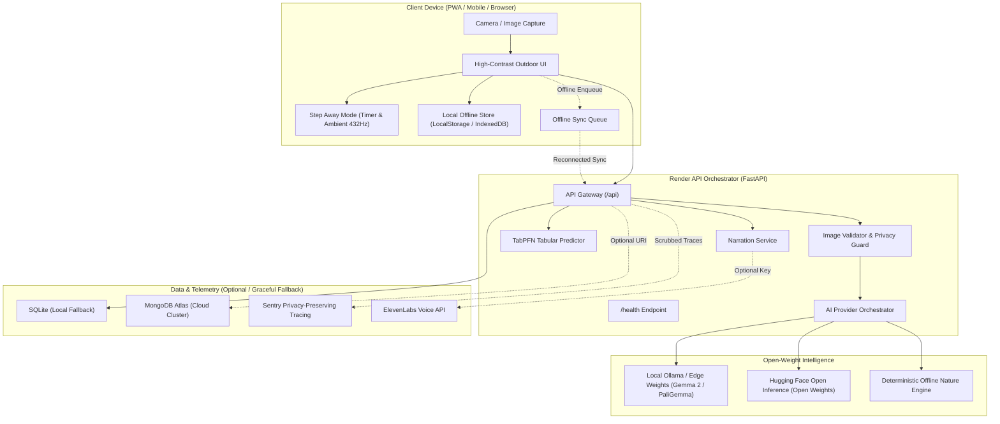
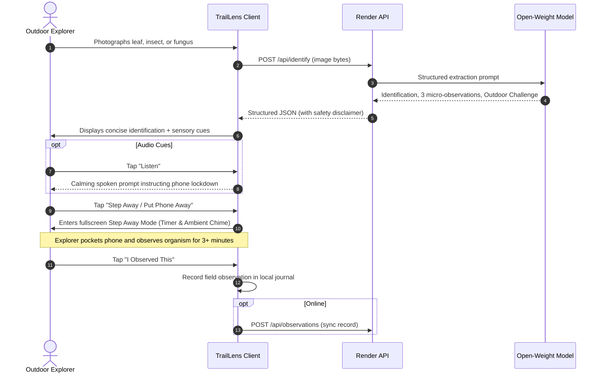

# TrailLens Architecture & System Design

> **"See something. Understand it. Step away."**

TrailLens is an offline-first nature companion powered by open-weight AI. Its explicit objective is to minimize screen engagement and maximize direct sensory exploration of the physical world.

---

## 1. High-Level System Architecture



---

## 2. Core User Flow

The interaction sequence is intentionally designed to terminate in the real world:



---

## 3. Mandatory vs. Optional Components

To ensure extreme resilience and developer accessibility, TrailLens separates core functional pillars from cloud augmentations:

| Component | Status | Behavior When Unconfigured / Offline |
|---|---|---|
| **Open-Weight AI Provider** | **Mandatory** | Runs via local Ollama or Hugging Face open weights. Defaults to the built-in deterministic offline nature engine with zero API key dependencies. |
| **Offline Field Store** | **Mandatory** | Observations and queues are stored on the device using browser LocalStorage / IndexedDB. |
| **Render Deployment** | **Mandatory** | Dockerfile and `render.yaml` provide 1-click cloud orchestration with `/health` monitoring. |
| **Outdoor Challenge Engine** | **Mandatory** | Curated catalog of zero-screen mindfulness and sensory tasks. |
| **MongoDB Atlas** | *Optional* | If `MONGODB_URI` is omitted, the backend automatically uses a local persistent SQLite database (`traillens_local.db`). |
| **TabPFN Tabular Predictor** | *Optional* | If `tabpfn` is installed, runs TabPFNClassifier. Defaults to a calibrated 5-fold cross-validated Random Forest baseline on historical weather logs. |
| **ElevenLabs Audio** | *Optional* | If `ELEVENLABS_API_KEY` is omitted, speech is generated client-side using the native browser Web Speech API. |
| **Sentry Telemetry** | *Optional* | Active only when `SENTRY_DSN` is set. Raw photos, base64 payloads, and GPS coordinates are strictly scrubbed prior to dispatch. |

---

## 4. Open-Weight Model Modularity

The AI architecture adheres to an abstract `AIProvider` contract:

```python
class AIProvider(ABC):
    @property
    @abstractmethod
    def name(self) -> str: ...

    @property
    @abstractmethod
    def model_name(self) -> str: ...

    @property
    @abstractmethod
    def license(self) -> str: ...

    @property
    @abstractmethod
    def is_offline(self) -> bool: ...

    @abstractmethod
    async def identify(self, image: Image.Image, user_hint: Optional[str] = None) -> IdentificationResult: ...
```

### Substituting Another Open Model

To replace Google Gemma 2 / PaliGemma with another open-weight model (e.g. Qwen2-VL, Moondream2, or a locally fine-tuned botanical checkpoint):

1. **Via Environment Variable (Ollama)**:
   ```env
   AI_PROVIDER=open_model
   OLLAMA_BASE_URL=http://localhost:11434
   OPEN_MODEL_NAME=qwen2-vl
   ```
2. **Via Custom Class**:
   Implement a new class inheriting from `AIProvider` in `backend/app/ai/custom_provider.py` and register it inside `backend/app/ai/factory.py`.

---

## 5. Offline Data Synchronization Strategy

When an explorer is on a deep woodland trail with zero cellular reception:

1. **Capturing**: Observations and challenges are generated and saved immediately to local client storage.
2. **Queueing**: A unique `client_id` (UUID) is assigned, and the payload is appended to `traillens_sync_queue`.
3. **Detection**: The client monitors window `online` and `offline` events.
4. **Reconciliation**: When connectivity is restored, the client issues a `POST /api/observations/sync` batch request. The backend inserts or reconciles the entries into MongoDB Atlas or the SQLite store without duplicating entries.
